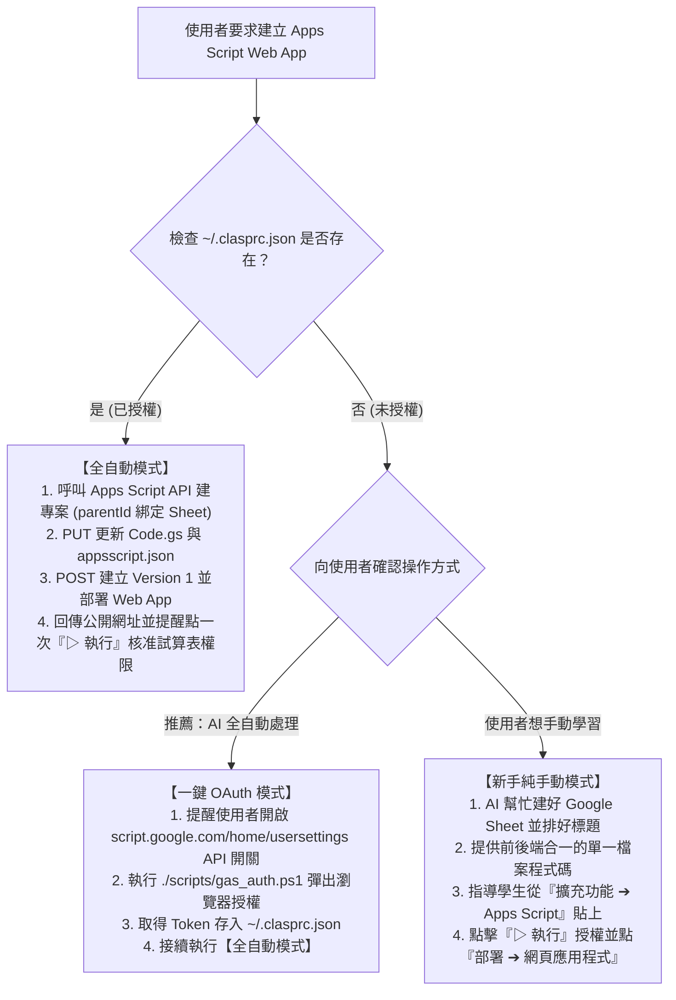

# Google Apps Script (GAS) 自動連動與 Web App 部署指南（AI 助手運作守則）

本技能指導 AI 助手（Antigravity Agent）如何**正確、無死角、完全不卡死**地連動 Google Apps Script，並將程式碼部署為公開的網頁應用程式（Web App）。

---

## 🛑 AI 助手防卡死三大鐵律 (CRITICAL RULES)

1. **嚴禁使用 Google Drive API (`drive/v3/files`) 建立 `application/vnd.google-apps.script` 檔案！**
   - ⚠️ 呼叫 Drive API 建立的 script 檔案只是 0 byte 索引空殼，點開**必定 404 Not Found**，會導致使用者與 AI 陷入除錯死循環。
2. **建立專案的唯二合法管道：**
   - **全自動 API 管道**：呼叫 `POST https://script.googleapis.com/v1/projects`（需帶入 `parentId` 綁定 Google Sheet）。
   - **引導使用者管道**：請使用者打開 Google Sheet，點選上方選單 **「擴充功能」➔「Apps Script」**（容器內建立，絕不 404）。
3. **強制採用單一檔案（Single-file）架構：**
   - 不要要求使用者分別建立 `Code.gs` 與 `Index.html`。
   - 將前端網頁完整內嵌於 `doGet()` 的 `HtmlService.createHtmlOutput(...)` 中，避免檔案遺失或大小寫打錯。

---

## 🤖 AI 助手執行決策樹 (Agent Decision Tree)

當使用者說「幫我用 Google Apps Script 做一個網頁/打卡系統」時，AI 應依序執行以下判斷：



---

## 一、全自動模式操作手冊 (Agent API Automation)

若 `~/.clasprc.json` 存在，AI 助手可直接在終端機執行 REST API 完成全自動發布：

### 1. 取得 Access Token
```powershell
$clasp = Get-Content -Raw "$HOME\.clasprc.json" | ConvertFrom-Json
$token = $clasp.token.access_token
$headers = @{ Authorization = "Bearer $token" }
```

### 2. 建立專案並綁定 Google Sheet
```powershell
$body = '{"title":"' + $ProjectName + '","parentId":"' + $SpreadsheetId + '"}'
$proj = Invoke-RestMethod -Uri "https://script.googleapis.com/v1/projects" -Method Post -Headers $headers -ContentType "application/json; charset=utf-8" -Body ([System.Text.Encoding]::UTF8.GetBytes($body))
$scriptId = $proj.scriptId
```

### 3. 上傳程式碼與 Web App 清單 (Manifest)
```powershell
# 將 Code.gs 與 appsscript.json 組合為 payload，呼叫 PUT
PUT https://script.googleapis.com/v1/projects/$scriptId/content
```
*註：`appsscript.json` 必須包含 `"webapp": { "executeAs": "USER_DEPLOYING", "access": "ANYONE_ANONYMOUS" }`*

### 4. 發布公開 Web App
```powershell
# 1. 建立 Version
POST https://script.googleapis.com/v1/projects/$scriptId/versions -d '{"description":"v1"}'
# 2. 建立 Deployment
POST https://script.googleapis.com/v1/projects/$scriptId/deployments -d '{"versionNumber":1,"manifestFileName":"appsscript","description":"公開部署"}'
```
API 回傳中的 `entryPoints[0].webApp.url` 即為公開打卡網址！

---

## 二、使用者首次授權 SOP (OAuth Handshake)

若尚未授權，AI 助手應依序執行：
1. **提醒使用者檢查 API 開關**：
   打開 [script.google.com/home/usersettings](https://script.google.com/home/usersettings) 確認「Google Apps Script API」已切換為「開啟 (ON)」。
2. **啟動本機授權監聽**：
   執行本技能隨附腳本 `scripts/gas_auth.ps1`，它會自動開啟瀏覽器引導使用者完成登入與授權，並自動將憑證儲存於 `~/.clasprc.json`。

---

## 三、關鍵提醒：為什麼發布後還要使用者點一次「▷ 執行」？

> [!IMPORTANT]
> Google 的安全隔離機制：
> 外部 API（即使擁有 `script.projects` 權限）只能上傳程式碼與建立部署，**不能越權代表使用者直接同意腳本對 Google Sheet 的讀寫權限**。
> 因此，發布後 AI 必須清楚告知使用者：
> **請在瀏覽器專案編輯器中，點擊一次「▷ 執行 (Run)」並允許權限。完成後，公開網頁才會正式對所有人開放！**
