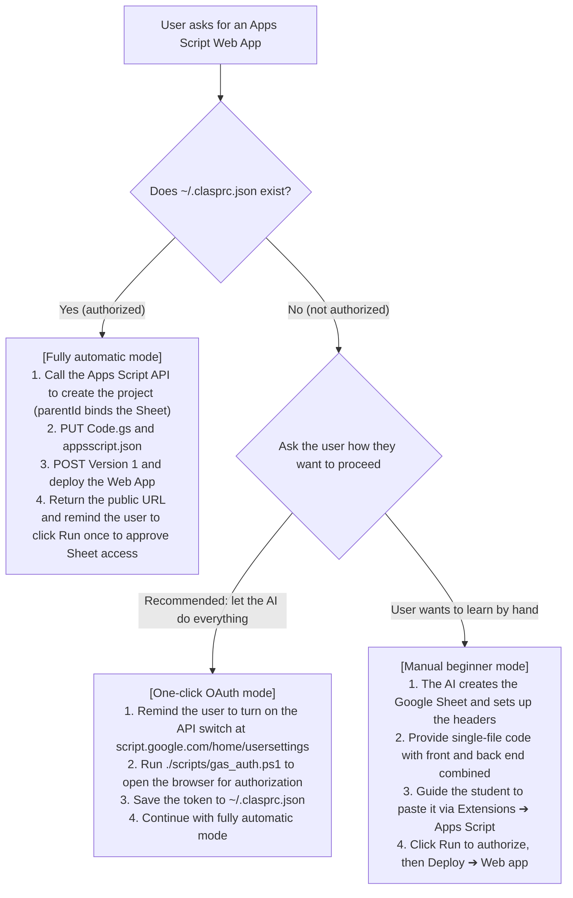

# Google Apps Script (GAS) integration and Web App deployment (operating rules for the AI assistant)

This skill tells the AI assistant (Antigravity Agent) how to connect to Google Apps Script **correctly, completely and without getting stuck**, and how to deploy code as a public Web App.

---

## 🛑 Three rules to avoid getting stuck (CRITICAL RULES)

1. **Never use the Google Drive API (`drive/v3/files`) to create an `application/vnd.google-apps.script` file!**
   - ⚠️ A script file created through the Drive API is only a 0-byte index shell. Opening it **always returns 404 Not Found**, trapping the user and the AI in an endless debugging loop.
2. **There are only two valid ways to create a project:**
   - **Fully automatic API route**: call `POST https://script.googleapis.com/v1/projects` (with `parentId` to bind it to a Google Sheet).
   - **Guided route**: have the user open the Google Sheet and choose **Extensions ➔ Apps Script** from the menu (created inside the container, never a 404).
3. **Always use a single-file architecture:**
   - Do not ask the user to create separate `Code.gs` and `Index.html` files.
   - Embed the whole front end in `HtmlService.createHtmlOutput(...)` inside `doGet()`, so no file goes missing or gets its name capitalised wrongly.

---

## 🤖 Agent decision tree

When the user says "build me a web page / clock-in system with Google Apps Script", the AI should decide as follows:



---

## 1. Fully automatic mode (Agent API automation)

If `~/.clasprc.json` exists, the AI assistant can publish entirely from the terminal with the REST API:

### 1. Get the access token
```powershell
$clasp = Get-Content -Raw "$HOME\.clasprc.json" | ConvertFrom-Json
$token = $clasp.token.access_token
$headers = @{ Authorization = "Bearer $token" }
```

### 2. Create the project and bind it to the Google Sheet
```powershell
$body = '{"title":"' + $ProjectName + '","parentId":"' + $SpreadsheetId + '"}'
$proj = Invoke-RestMethod -Uri "https://script.googleapis.com/v1/projects" -Method Post -Headers $headers -ContentType "application/json; charset=utf-8" -Body ([System.Text.Encoding]::UTF8.GetBytes($body))
$scriptId = $proj.scriptId
```

### 3. Upload the code and the Web App manifest
```powershell
# Combine Code.gs and appsscript.json into one payload, then call PUT
PUT https://script.googleapis.com/v1/projects/$scriptId/content
```
*Note: `appsscript.json` must contain `"webapp": { "executeAs": "USER_DEPLOYING", "access": "ANYONE_ANONYMOUS" }`*

### 4. Publish the public Web App
```powershell
# 1. Create a version
POST https://script.googleapis.com/v1/projects/$scriptId/versions -d '{"description":"v1"}'
# 2. Create a deployment
POST https://script.googleapis.com/v1/projects/$scriptId/deployments -d '{"versionNumber":1,"manifestFileName":"appsscript","description":"Public deployment"}'
```
`entryPoints[0].webApp.url` in the API response is the public clock-in URL!

---

## 2. First-time user authorization SOP (OAuth handshake)

If the user has not authorized yet, the AI assistant should:
1. **Remind the user to check the API switch**:
   open [script.google.com/home/usersettings](https://script.google.com/home/usersettings) and make sure "Google Apps Script API" is turned **On**.
2. **Start the local authorization listener**:
   run the bundled script `scripts/gas_auth.ps1`. It opens the browser, walks the user through sign-in and consent, and saves the credentials to `~/.clasprc.json`.

---

## 3. Key reminder: why does the user still need to click Run once after publishing?

> [!IMPORTANT]
> Google's security isolation:
> An external API (even with the `script.projects` scope) can only upload code and create deployments. It **cannot consent on the user's behalf to the script reading and writing their Google Sheet**.
> So after publishing, the AI must clearly tell the user:
> **Open the project in the browser editor, click Run once and allow the permissions. Only then does the public web page open to everyone!**
