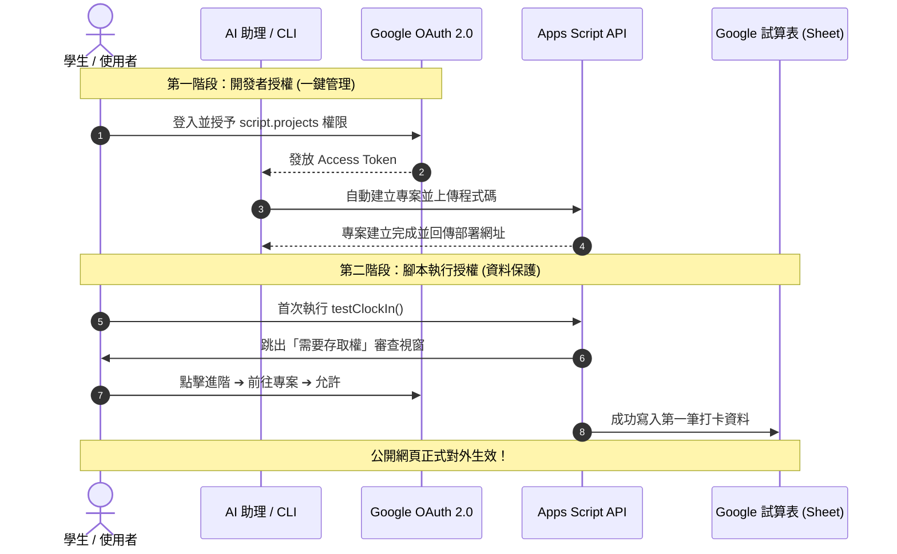

# Google Apps Script 授權與 Web App 部署新手教學指南

本技能（Skill）專門指導學生與初學者如何正確完成 **Google Apps Script (GAS)** 的權限授權，並成功將專案公開部署為可供任何人使用的網頁應用程式（Web App）。

> [!IMPORTANT]
> **新手必記兩大核心坑點：**
> 1. **未開啟 Apps Script API 開關**：前往 [https://script.google.com/home/usersettings](https://script.google.com/home/usersettings) 將「Google Apps Script API」開啟。若未開啟，任何外部 API 或工具都無法建立/修改專案。
> 2. **外部建立空殼專案導致 404**：若僅透過 Google Drive 建立空檔案（0 byte），未經 Apps Script 容器初始化，點開專案連結會報 `404 Not Found`。必須從 Google Sheet 內部「擴充功能 ➔ Apps Script」開啟，或由 `script.googleapis.com` 初始化。

---

## 一、Google Apps Script 權限體系概念解析

### 1. 什麼是 Google Apps Script？
Google Apps Script (GAS) 是 Google 基於 JavaScript (V8 引擎) 開發的雲端腳本平台，能直接操控 Google Sheets、Forms、Gmail、Drive 等服務，並可透過 `doGet()` / `doPost()` 將腳本發布為公開網頁。

### 2. 為什麼需要兩道授權？
在 GAS 的世界中，存在兩種完全不同的授權層次：
- **開發者管理權限（API 管理層）**：允許外部工具（如 AI 助理、clasp CLI）幫你在雲端新增專案、上傳程式碼。
- **腳本執行資料存取權（Runtime 執行層）**：腳本在雲端執行時，需要 Google 帳號主人授權它讀寫特定的 Google Sheet 或寄送 Gmail。



---

## 二、方式一：新手入門手動操作法（瀏覽器零工具）

最直覺、免安裝任何指令列工具的方式，適合課堂初次體驗。

### 步驟 1：建立並綁定 Google 試算表
1. 前往 Google Drive，新增一張 Google 試算表，命名為 `員工上班打卡紀錄表`。
2. 第一列設定欄位標題：`姓名`、`打卡時間`、`打卡類型`、`備註`。
3. 點選上方選單：**「擴充功能 (Extensions)」➔「Apps Script」**。
   *(以此方式建立的專案已自動與試算表綁定，絕對不會出現 404！)*

### 步驟 2：貼上單一檔案完整程式碼
1. 在編輯器中將原本的 `function myFunction() {}` 全部刪除。
2. 複製 `examples/clock_in_webapp.gs` 的內容並貼上。
3. 確認最上方的 `CONFIG.SPREADSHEET_ID` 填入你的試算表 ID。
4. 按下鍵盤 **`Ctrl + S`** 儲存專案。

### 步驟 3：執行首次授權測試（關鍵！）
1. 編輯器上方函式下拉選單選擇 `testClockIn`。
2. 點擊工具列的 **「▷ 執行」**。
3. 此時 Google 會跳出授權視窗，請依序點擊：
   - **審查權限 (Review Permissions)**
   - 選擇你的 Google 帳號
   - 出現「Google 尚未驗證這個應用程式」時，點擊左下角 **「進階 (Advanced)」**
   - 點擊 **「前往『未命名專案』(不安全)」**
   - 點擊右下角 **「允許 (Allow)」**
4. 查看下方執行紀錄，顯示「✅ 打卡寫入成功！」，切回 Google Sheet 即可看到第一筆資料。

### 步驟 4：公開部署為 Web App
1. 點擊右上角藍色按鈕 **「部署 (Deploy)」➔「新增部署作業 (New deployment)」**。
2. 點擊左側齒輪圖示 ⚙️，勾選 **「網頁應用程式 (Web app)」**。
3. 關鍵欄位設定：
   - **說明**：`打卡系統 v1`
   - **執行身分 (Execute as)**：選 **「我 (Me)」**（重要！這樣一般打卡者不需要具備試算表權限即可寫入）。
   - **誰可以存取 (Who has access)**：選 **「所有人 (Anyone)」**（公開部署必選！若選僅限自己則他人無法打卡）。
4. 點擊 **「部署」**，複製產生的網址（結尾為 `/exec`），此網址即可發給所有人用手機或電腦打卡。

---

## 三、方式二：進階 AI / CLI 自動化授權部署（無痛一鍵完成）

適合希望讓 AI 助理直接接手全部編寫與發布工作的進階教學。

### 架構原理
利用 Google 官方開源工具 `@google/clasp` 登記的 OAuth Client ID：
`1072944905499-vm2v2i5dvn0a0d2o4ca36i1vge8cvbn0.apps.googleusercontent.com`
在本地啟動臨時 HTTP 監聽服務，攔截 Google 回傳的授權碼並換取 Token，存入 `~/.clasprc.json`。

### 執行步驟
1. 確保已開啟 [Apps Script 使用者設定](https://script.google.com/home/usersettings) 中的 API 開關。
2. 執行授權腳本：
   ```powershell
   powershell -ExecutionPolicy Bypass -File ./scripts/gas_auth.ps1
   ```
3. 瀏覽器自動彈出授權畫面，點擊「允許」。
4. 執行自動部署腳本：
   ```powershell
   powershell -ExecutionPolicy Bypass -File ./scripts/deploy_webapp.ps1
   ```
5. 終端機將直接印出公開 Web App 網址！

---

## 四、常見報錯與新手避坑指南 (FAQ)

| 錯誤現象 | 根本原因 | 解決方式 |
| :--- | :--- | :--- |
| **點開專案連結顯示 404** | 從外部 Drive API 建立空檔案，未經 Apps Script 引擎初始化 | 一律從 Google Sheet「擴充功能 ➔ Apps Script」開啟，或由 API 的 `/v1/projects` 建立。 |
| **Google Apps Script API has not been used or disabled** | 帳號未開啟 API 外部呼叫開關 | 前往 [script.google.com/home/usersettings](https://script.google.com/home/usersettings) 開啟開關。 |
| **打開 Web App 顯示「需要存取權」** | 專案尚未在編輯器內由擁有者審查通過存取權限 | 打開編輯器，點擊「▷ 執行」任一函式，完成 Google 帳號授權即可。 |
| **其他人打開網頁顯示登入畫面** | 部署時「誰可以存取」未設定為「所有人」 | 點擊部署 ➔ 管理部署作業 ➔ 修改設定 ➔ 誰可以存取改為「所有人 (Anyone)」。 |
| **打卡成功但 Google Sheet 沒增加資料** | 試算表 ID 填錯，或 Sheet 名稱與程式碼不一致 | 檢查 `CONFIG.SPREADSHEET_ID` 與 `CONFIG.SHEET_NAME` 是否與試算表分頁名稱相符。 |
